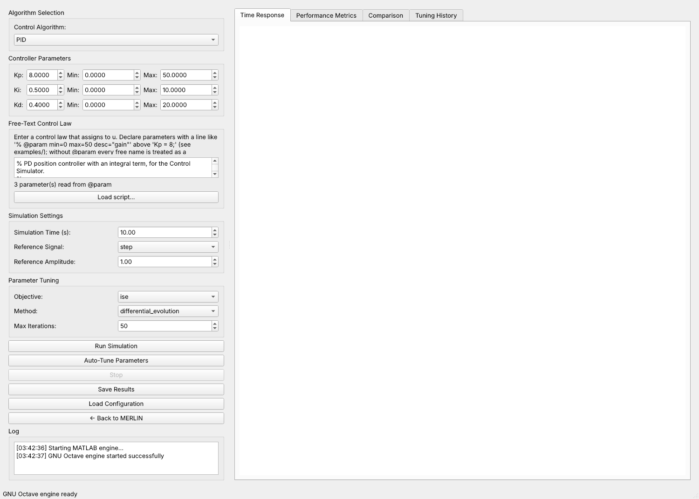
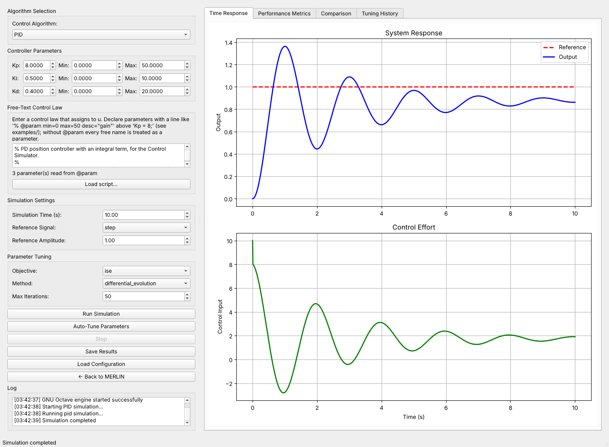
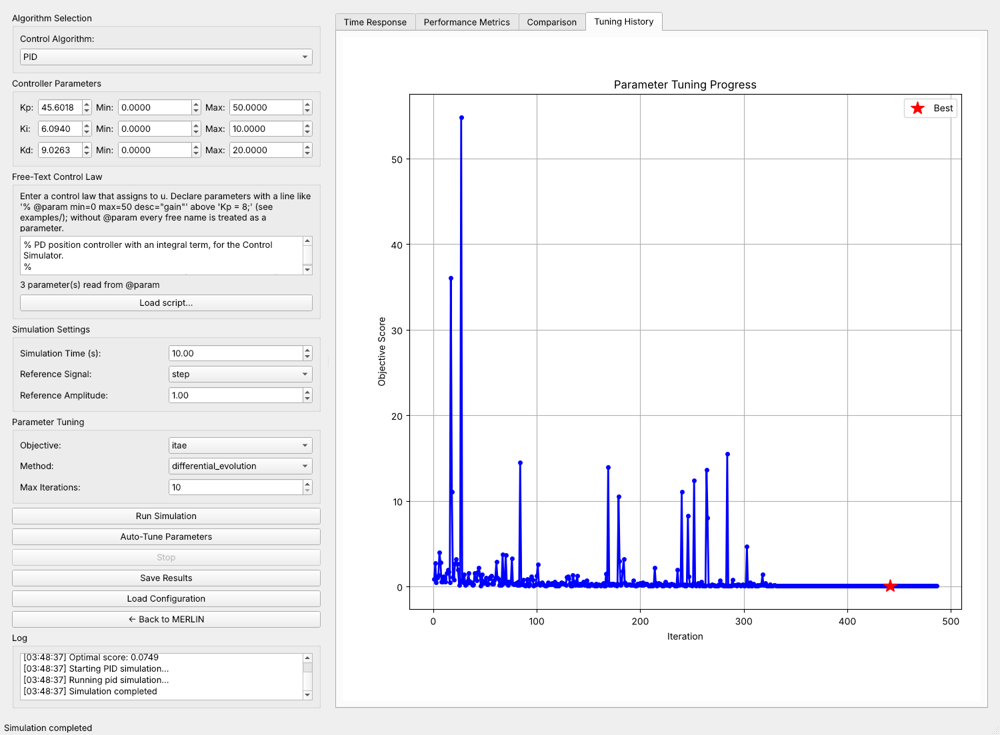
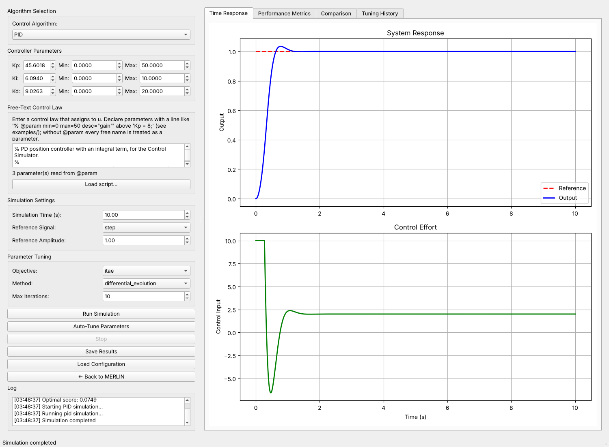
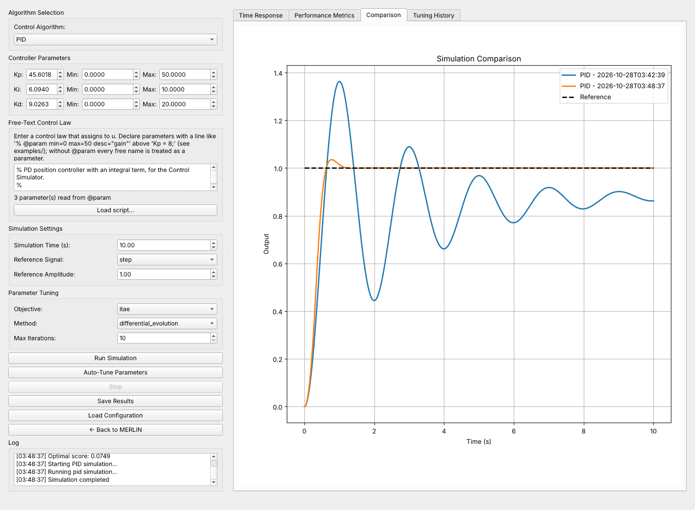

# Control Simulator: worked example in the MATLAB window

The Control Simulator (`arm_bench_dev/src/control_simulator/`, opened from MERLIN's Control tab or with
`arm-bench matlab-tune`) lets you type a control law, simulate it with the MATLAB scripts in `matlab_scripts/` on a
mass–spring–damper plant, and tune its parameters automatically. This page walks through one complete session in the
window and documents the `@param` syntax that makes the script the single source of truth for parameters, bounds and
tuning ranges.

**How this example was produced.** The session below was run in the actual window. The MATLAB Engine for Python was not
available on the machine, so the window used its GNU Octave fallback, which executes the same `.m` files
(`run_control_sim.m`, `eval_custom_law.m`). The screenshots and numbers are from that run
(`docs/images/control_simulator/walkthrough_run.json`). With MATLAB installed, the window uses MATLAB instead and the
status bar says *MATLAB engine ready*; the simulation is deterministic, so the results are the same up to floating-point
rounding. The tests `arm_bench_dev/tests/test_octave_backend.py` check that the `.m` scripts and the Python mirror
`python_sim.py` agree to 1e-9 on step, sine, ramp and square references.

## 1. The plant and the variables a law can use

```
m = 1 kg, b = 0.5 N s/m, k = 2 N/m      x = [position; velocity],  ẋ = A x + B u,  y = position
step 10 ms, explicit Euler, |u| ≤ 10 N
```

A control law is a MATLAB snippet that assigns `u`. It can read `e` (r − y), `integral` (Σ e·dt), `derivative`
((e − e_prev)/dt; it equals 100·e at the first sample, which saturates `u` at t = 0 for a step), `x`, `r`, `t`, `dt`, and
its own parameters.

## 2. Declaring parameters: `@param`

```matlab
% @param min=0 max=50 desc="proportional gain" unit="N/m"
Kp = 8.0;

Ki = 0.5;   % @param min=0 max=10 desc="integral gain"

% @param Kd default=0.4 min=0 max=20          (no assignment needed)

u = Kp*e + Ki*integral + Kd*derivative;
```

| rule | |
|---|---|
| marker | `%` (MATLAB), `#` or `//`, then `@param` |
| options | `min`, `max`, `default`, `step`, `unit`, `desc` (quote values with spaces) |
| applies to | the assignment on the same line; or, for an annotation alone on its line, the next code line; or the explicit name in `@param NAME …` |
| default | the assigned number or constant expression (`2*pi` works), else `default=` |
| missing `min`/`max` | derived from the default (0…10×, or ±10× for negatives) **with a warning** |
| removed from the executable | the annotated assignments are not executed, otherwise they would overwrite the tuned values |
| errors (shown under the script) | `min ≥ max`, default outside `[min, max]`, reserved names (`u e dt integral derivative x r t …`), duplicates, an annotation with nothing to apply to, non-numeric values |
| no `@param` anywhere | earlier behaviour: every free identifier becomes a parameter with range 0…100 |

## 3. The session

### Step 1 — load the script

Start the window, wait for *engine ready* in the status bar, press **Load script…** and choose
`examples/pd_position.m`. The parameter table fills with `Kp = 8, Ki = 0.5, Kd = 0.4` and the ranges `[0, 50]`,
`[0, 10]`, `[0, 20]`; the line under the script says *3 parameter(s) read from @param*.



### Step 2 — run with the declared values

Reference `step`, amplitude 1, 10 s, **Run Simulation**:



| rise time (10–90 %) | settling (2 %) | overshoot | steady-state error at 10 s | ISE | ITAE | peak u |
|---|---|---|---|---|---|---|
| 0.42 s | does not settle | 36.3 % | 0.138 | 0.730 | 7.595 | 10 (saturated) |

The loop oscillates with a period of about 2 s, and the integral action is still removing the error at 10 s. The closed
loop is stable: its characteristic polynomial s³ + (b + K_d)s² + (k + K_p)s + K_i = s³ + 0.9 s² + 10 s + 0.5 satisfies
the Routh–Hurwitz condition 0.9·10 > 0.5, but the damping is small.

### Step 3 — tune

Objective `itae`, method `differential_evolution`, **Max Iterations** 10 (the minimum of the field), **Auto-Tune
Parameters**. The tuner searches exactly the declared box `[0, 50] × [0, 10] × [0, 20]`; differential evolution is
followed by a bounded L-BFGS-B polish. In this run it evaluated 486 parameter sets. The Tuning History tab shows the
objective of every evaluation, with the best one starred:



When tuning ends, the window writes the optimum into the parameter table and asks *Run simulation with optimal
parameters?*; answering *Yes* runs it:



| | Kp | Ki | Kd | rise | settling | overshoot | ss. error | ISE | ITAE |
|---|---|---|---|---|---|---|---|---|---|
| declared values | 8.0 | 0.5 | 0.4 | 0.42 s | – | 36.3 % | 0.138 | 0.730 | 7.595 |
| tuned for ITAE | 45.60 | 6.094 | 9.026 | 0.38 s | 0.96 s | 3.5 % | 0.000 | 0.261 | 0.0749 |

The Comparison tab overlays the two runs:



### Step 4 — read the result critically

* `u` is saturated at +10 for the first 0.3 s of the tuned response. The rise time is therefore limited by the actuator,
  not by the gains: a larger `Kp` cannot make the response faster.
* `Kp` ends at 45.6, close to its declared upper bound of 50. Raise `max` in the script and re-tune to check whether the
  bound is active. On this plant the optimum stays close, because the response is limited by saturation.
* The ITAE objective weights late errors heavily, so it trades a slightly slower rise for a small overshoot. Tuning for
  `ise` instead gives a faster rise with more overshoot.
* The optimiser is stochastic: another run gives slightly different gains with practically the same ITAE.
* **Save Results** writes the session (parameters, responses, metrics) to a JSON file that **Load Configuration** reads
  back into the Comparison tab.

## 4. Second example: feed-forward instead of an integral

`examples/pd_with_feedforward.m` uses `Kp = 6, Kd = 1.2` and a spring feed-forward `Kff*r` (declared with a standalone
`% @param Kff default=2.0 …`; the plant's spring is 2 N/m, so the ideal value is 2). It removes the steady-state error
without an integral term (error 0.000, settling 4.8 s, overshoot 38.7 %), and it shows that a standalone declaration and
the `#` marker work. It is not tuned.

## 5. Without the window (tests, CI, a quick look)

```python
from control_simulator.python_sim import simulate, PythonSimulator
from control_simulator.parameter_tuner import ParameterTuner, bounds_from_script

text = open("examples/pd_position.m").read()
print(simulate(text)["metrics"])                       # the declared values
tuner = ParameterTuner(PythonSimulator())              # the same tuner the window uses
best = tuner.tune_parameters("pid", bounds_from_script(text), objective="itae",
                             max_iterations=15, control_law_text=text)
```

`python_sim.py` evaluates the scalar subset of MATLAB that the examples use (assignments, `+ − * / ^`, `sin cos tan exp log
sqrt abs max min sign pi`, comments). `if/for/while` raise `UnsupportedLaw`; use the window for those.

## 6. Installing an engine

* **MATLAB:** install the MATLAB Engine API for Python (`pip install matlabengine` matching your MATLAB release).
* **GNU Octave (fallback):** `sudo apt install octave` and `pip install oct2py`. The window picks Octave automatically
  when the MATLAB engine cannot be imported.

## 7. Writing your own script: checklist

* Put every tunable number in an annotated assignment and give it `min`/`max` (the tuner needs them).
* Keep the final line an assignment to `u`.
* Leave constants that are not meant to be tuned as plain assignments without `@param`: they stay in the executed body.
  Do not assign again to a declared name (that would overwrite the tuned value; the parser warns).
* The simulator's plant is fixed; for your own plant edit `matlab_scripts/run_control_sim.m`.
